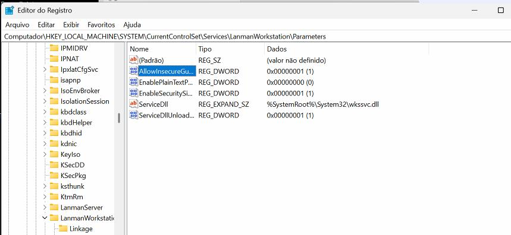
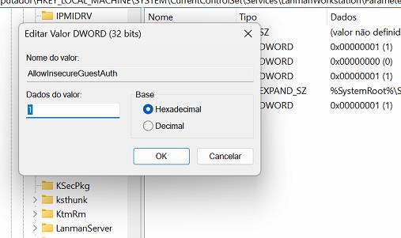
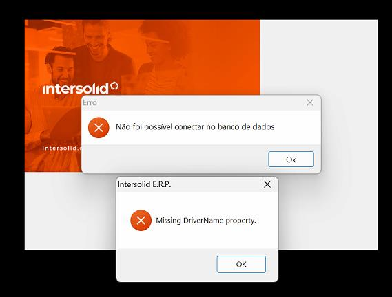
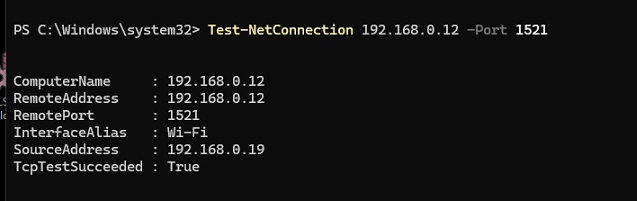
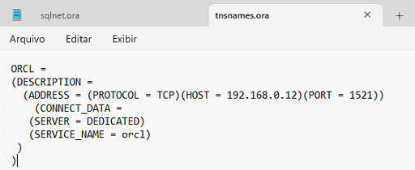
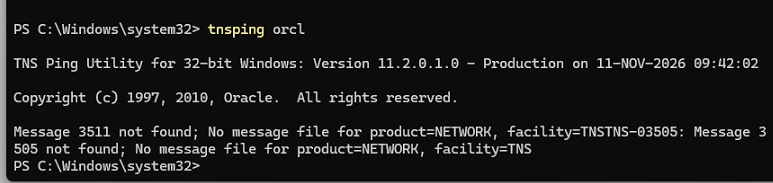
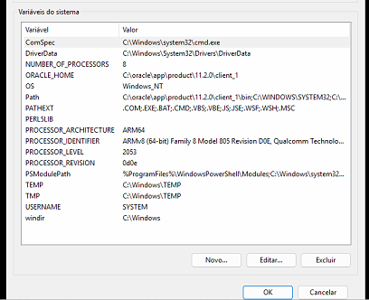
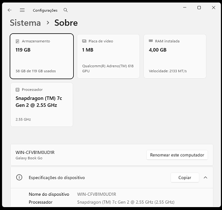
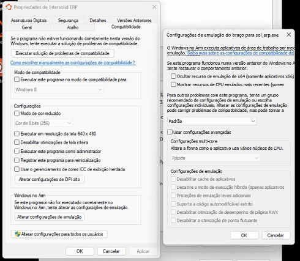
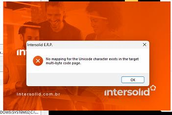

# Instalação do ERP: 3 problemas (Windows Home, Windows ARM e licença local)

Resolução de três problemas que podem aparecer ao instalar o sistema em uma estação: o Windows Home não tem o gpedit para liberar a pasta do servidor, o processador ARM (neste caso, um Snapdragon) impede o sistema de abrir, e o erro "No mapping for the Unicode" da licença local. Passo a passo de cada um.

## Resumo rápido

| Problema | O que resolveu |
|---|---|
| **Problema 1 – Windows Home:** `\\IP` não abre / Erro 3227320323 e o gpedit.msc não existe | Registro: criar `RequireSecuritySignature` = 0 (e `AllowInsecureGuestAuth` = 1). Reiniciar. |
| **Problema 2 – Windows ARM:** Missing DriverName property + "Não foi possível conectar no banco de dados" | Conferir a variável `ORACLE_HOME` = `C:\oracle\app\product\11.2.0\client_1`. Em notebook ARM, mudar a emulação do `SOL_ERP.exe`. |
| **Problema 3 – Licença local:** No mapping for the Unicode character exists in the target multi-byte code page. | Apagar `C:\Solidus\licsol_erp.json` e abrir pelo iSOLIDUS. |

O Problema 1 só acontece se o PC for Windows Home. O Problema 2 só acontece se o processador for ARM (o mais comum hoje é o Snapdragon, mas não é o único). O Problema 3 já aconteceu em outros PCs e tem tutorial próprio, mas está aqui porque apareceu na sequência. Neste notebook os três vieram um depois do outro.

## Problema 1 – Windows Home: não acessa a pasta do servidor e não tem gpedit

**Sintoma:** no Explorador de Arquivos, ao digitar `\\IP` do servidor (para pegar as pastas Solidus e Temp), o Windows não localiza. No Prompt de Comando, o teste abaixo mostra o erro:

```
net use \\192.168.0.12\Solidus  →  Erro de sistema 3227320323
```

**Por que acontece:** esse erro quer dizer que o notebook chega no servidor, então a rede está ok. Quem bloqueia é o próprio Windows 11 nas versões mais novas: ele passou a exigir uma "assinatura" na conexão com pastas de rede e a barrar o acesso sem usuário. Servidores antigos ou Linux não atendem essa exigência.

!!! warning "Diferença para o tutorial que já existe"
    O manual "Windows não acessa compartilhamento iSolidus" resolve isso ativando o SMB 1.0 e habilitando "logons de convidado não seguros" pelo `gpedit.msc`. Esse caminho só funciona em Windows **Pro**. No Windows **Home** o gpedit não existe ("O Windows não pode encontrar gpedit.msc"), então o tutorial antigo para no passo 3. Para o Home, use o caminho pelo Registro, logo abaixo.


*Windows Home: o gpedit.msc não existe nessa versão*

### Como resolver no Windows Home: pelo Registro

1. Tecla **Windows + R** > digite `regedit` > **Enter** > clique em **Sim**.
2. Cole na barra de endereço de cima e dê **Enter**:
   `HKEY_LOCAL_MACHINE\SYSTEM\CurrentControlSet\Services\LanmanWorkstation\Parameters`
3. Confira se `AllowInsecureGuestAuth` existe com valor **1**. Se não existir: botão direito no espaço vazio > **Novo** > **Valor DWORD (32 bits)**, dê esse nome e coloque o valor 1.
4. Crie também o `RequireSecuritySignature` (**Novo** > **Valor DWORD 32 bits**) com valor **0**. Foi esse que destravou o acesso. Mesmo que ele não apareça na lista, o Windows exige a assinatura, por isso precisa ser criado.
5. Reinicie o notebook.



*A pasta Parameters do Registro, com o AllowInsecureGuestAuth já em 1*



*Editando o valor do DWORD*

**Teste:** no Prompt de Comando, rode `net use \\IP\Solidus /user:IP\administrador` (com o IP do servidor). Tem que aparecer "Comando concluído com êxito".

!!! tip "Atalho pelo PowerShell"
    No PowerShell aberto como administrador, faz o mesmo:
    ```
    Set-SmbClientConfiguration -RequireSecuritySignature $false
    Set-SmbClientConfiguration -EnableInsecureGuestLogons $true
    ```

## Problema 2 – Windows ARM: o sistema não abre

### 2.0 O erro

Com a pasta liberada, a instalação segue normal: instalar o Oracle Client 32 bits, copiar o `tnsnames.ora` e criar o atalho do iSOLIDUS. Ao abrir, porém, aparecem estes erros:



*Os dois erros que aparecem juntos*

**O que significa:** o sistema não conseguiu montar a conexão com o banco Oracle. Vale testar por camadas, para saber onde está o problema.

### 2.1 Primeiro, descartar rede e Oracle: a rede chega no banco?

No PowerShell, rode `Test-NetConnection IP_DO_SERVIDOR -Port 1521`. Se der `TcpTestSucceeded : True`, a rede está ok, mesmo pelo Wi-Fi. Assim você descarta cabo e roteador.



*Rede ok até o banco, pelo Wi-Fi*

### 2.2 O Oracle do notebook funciona?

No Prompt de Comando, rode `tnsping` seguido do nome que está no começo do `tnsnames.ora` (no caso, `ORCL`):



*tnsnames.ora: o nome (ORCL), o IP do servidor (HOST) e a porta*

Neste caso deu erro: "Message 3511 not found; No message file for product=NETWORK" e TNS-03505. Isso quer dizer que o Oracle não acha os próprios arquivos.



*tnsping com erro: o Oracle está procurando os arquivos no lugar errado*

### 2.3 Conferir a variável ORACLE_HOME

No Prompt de Comando, rode `where tnsping` e `echo %ORACLE_HOME%`. Os dois caminhos têm que bater:

```
C:\Users\Usuario>where tnsping
C:\oracle\app\product\11.2.0\client_1\BIN\tnsping.exe

C:\Users\Usuario>echo %ORACLE_HOME%
C:\Oracle\product\11.2.0\client_1
```
*O Oracle está em `C:\oracle\app\...`, mas a ORACLE_HOME aponta para `C:\Oracle\product\...` (sem o "app")*

1. Tecla **Windows** > digite "variáveis de ambiente" > **Editar as variáveis de ambiente do sistema** > botão **Variáveis de Ambiente...**
2. Em **Variáveis do sistema**, selecione `ORACLE_HOME` > **Editar**.
3. Troque o valor para `C:\oracle\app\product\11.2.0\client_1` > **OK** > **OK** > **OK**.
4. Feche o Prompt de Comando, abra outro e rode `tnsping ORCL` de novo. Tem que terminar com **OK**.

```
C:\Users\Usuario>tnsping ORCL
TNS Ping Utility for 32-bit Windows: Version 11.2.0.1.0 - Production

Arquivos de parâmetros usados:
C:\oracle\app\product\11.2.0\client_1\network\admin\sqlnet.ora

Usado o adaptador TNSNAMES para resolver o apelido
Tentativa de contatar (DESCRIPTION = (ADDRESS = (PROTOCOL = TCP)(HOST = 192.168.0.12)(PORT = 1521)) (CONNECT_DATA = (SERVER = DEDICATED) (SERVICE_NAME = orcl)))
OK (30 ms)
```
*Depois da correção: tnsping OK*

### 2.4 A causa: o processador é ARM

Neste caso a ORACLE_HOME estava errada e foi corrigida, mas isso não bastou: mesmo com o tnsping OK, o erro "Missing DriverName" continuou. Na tela de Variáveis de Ambiente, a variável `PROCESSOR_ARCHITECTURE` mostrou **ARM64**, com processador Qualcomm:



*PROCESSOR_ARCHITECTURE = ARM64: é um notebook Windows ARM*

Também dá pra confirmar em **Configurações** > **Sistema** > **Sobre**: em "Tipo de sistema" aparece "processador baseado em ARM", e o nome do processador mostra o modelo (neste caso, Snapdragon 7c Gen 2, notebook Galaxy Book Go).



*Configurações > Sistema > Sobre: processador Snapdragon*

**Por que importa:** o sistema e o Oracle Client foram feitos para processadores Intel/AMD. No ARM, o Windows roda esses programas por emulação, uma espécie de "tradução", e às vezes ela atrapalha. O jeito é deixar a emulação mais "cuidadosa" para o sistema:

1. Vá em `C:\Solidus`, clique com o botão direito no `SOL_ERP.exe` (ou no atalho dele, dá no mesmo) > **Propriedades** > guia **Compatibilidade**.
2. Em "Windows no Arm", clique em **Alterar configurações de emulação**.
3. Na lista que está em "Padrão", troque a opção > **OK** > **OK** e tente abrir o sistema. Não abriu? Volte e teste a próxima opção da lista, uma por uma, até abrir.



*Configurações de emulação do SOL_ERP.exe (Windows no Arm)*

Depois disso, o erro de banco sumiu e apareceu outro, o do Problema 3.

## Problema 3 – "No mapping for the Unicode character..." (licença local)



*Erro de licença local*

**Solução:**

1. Feche o sistema.
2. Em `C:\Solidus`, apague o arquivo `licsol_erp.json`.
3. Abra o sistema **somente pelo atalho do iSOLIDUS**.

!!! success "Resultado"
    O sistema abriu normalmente no notebook.

## Dicas para os próximos

- **Antes de tudo, veja a edição do Windows** (**Configurações** > **Sistema** > **Sobre** > **Especificações do Windows** > **Edição**). Se for Home, use o Registro no lugar do gpedit.
- **Antes de tudo, veja se o PC é ARM:** Variáveis de Ambiente > `PROCESSOR_ARCHITECTURE` = ARM64, ou **Configurações** > **Sistema** > **Sobre** > "Tipo de sistema" = "processador baseado em ARM". Não vá só pelo nome do processador: hoje o mais comum é o Snapdragon (Qualcomm), mas existem outros (ex.: Microsoft SQ, dos Surface). Se for Intel (Core, Celeron, Pentium) ou AMD (Ryzen, Athlon), não é ARM.
- **Teste por camadas:** pasta de rede (`net use`) > rede até o banco (`Test-NetConnection` porta 1521) > Oracle (`tnsping` e ORACLE_HOME) > programa (emulação e `licsol_erp.json`).
- **Se o erro mudou, é sinal de avanço:** a etapa anterior foi resolvida.
- **Se nada funcionar num notebook ARM**, as saídas são acesso remoto a um PC da loja (Área de Trabalho Remota/RemoteApp) ou usar uma máquina Intel/AMD.
